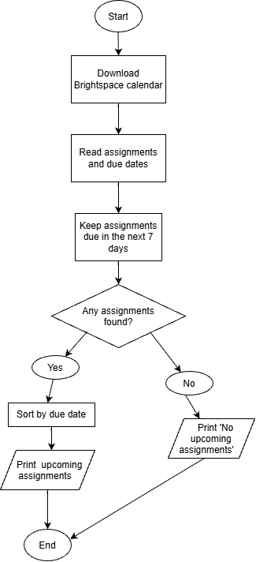

A web scraper that goes through Brightspace and prints out a list of all of the assignments I have due.
## The Problem

I want to make a website scraper that goes through my Brightspace ands gets me a list of all of the homework I have due in the next week or so.

## How It Works

The program will read my Brightspace calendar, find assignments due in the next seven days, and sort them by due date. It will then print the list in the terminal.

## Tech Stack

- **Language:** Java
- **Libraries:** iCal4j to read calendar data; Playwright for browser access
- **External tools:** Maven to manage libraries

## Setup

## Usage

## Roadmap

## Author

Wayland Xiong
